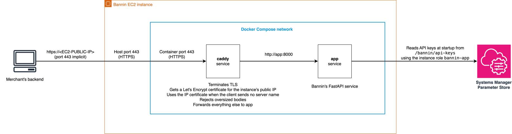

# Bannin

**Bannin is a work in progress.** It is being built as a real-time fraud-detection system that aims to determine whether an online card payment should be approved, reviewed, or declined before the merchant submits it for bank authorization.

## The Problem

Online card fraud is costly for merchants. When a legitimate cardholder disputes a fraudulent charge, the merchant typically loses the goods or services provided, the payment, and an additional chargeback fee. But blocking transactions too aggressively has a cost as well: every legitimate customer turned away represents a lost sale and potentially a lost customer. Merchants therefore need to stop fraud without turning away genuine customers.

Bannin focuses on card-not-present (CNP) fraud, a type of card fraud in which the physical card is not required to complete a transaction. It is common in online payments and occurs when a fraudster obtains a cardholder's payment information through various means, such as data breaches or phishing, and uses it to make unauthorized purchases.

CNP fraud is particularly challenging to detect because the physical card is absent and fraud techniques continuously evolve. Detection must happen within milliseconds, while the customer is checking out, using indirect signals such as the device, email address, IP address, and past behavior to determine whether a transaction is legitimate.

## Where Bannin Fits

Bannin is being built as a standalone service that the merchant's backend calls during checkout. When a customer places an order, the merchant's app sends it to the merchant's backend, which calls Bannin with the payment details and supporting signals such as the device, IP address, and email address. Bannin returns an approve, review, or decline decision. If the payment is approved or sent to review, the merchant's backend submits it to its payment processor, which routes the transaction to the cardholder's issuing bank for authorization.

The fraud-screening result Bannin provides is a preliminary risk assessment, not the bank's authorization decision. The issuer makes the final authorization decision based on its own checks, which may include available funds or credit, and card status.

Some large merchants build their own fraud-detection service in-house; others call a third-party API such as [Sift](https://sift.com/) or [Signifyd](https://www.signifyd.com/); and payment processors such as Stripe integrate fraud detection directly into their payment flow through products like [Stripe Radar](https://stripe.com/radar), so the merchant never calls a separate service. Bannin follows the in-house model, serving a single merchant, but exposes an API similar to that of a third-party service, allowing the merchant's backend to call it over the network like any other service.

## Current Architecture

Bannin currently runs as a single service on one AWS EC2 instance. The instance runs two Docker containers managed by Docker Compose: Caddy, which terminates HTTPS and forwards requests to the application, and the application itself, a Python service built with FastAPI.

The project also has a CI/CD pipeline built with GitHub Actions. On every push to `main`, it runs the tests, builds the application's container image, and publishes it to GitHub's container registry. Its deployment stage then checks whether Bannin's EC2 instance is running and, if it is, deploys the new image; otherwise, deployment is skipped. Since the project is still in its early stages, the infrastructure is provisioned with Terraform only when needed and torn down afterward to avoid unnecessary costs. If no instance is running when a change is pushed, the new image is still published, and the next instance created starts it automatically.

The following sections walk through this architecture from the inside out: first, how the application handles a request, then the AWS infrastructure it runs on, and finally the CI/CD pipeline that tests and deploys it.

### Application Request Flow

Currently, a payment request sent by the merchant's backend to `POST /score` passes through six stages in Bannin's application: API key authentication, request body checks, request validation, feature building, scoring, and decision-making. These stages form the foundation of the application's request-processing flow, but they will continue to evolve as development progresses.

#### 1. API Key Authentication

The application requires every request to include an API key in the `Authorization` header using the `Bearer` authentication scheme. This check is implemented in `src/bannin/auth.py`.

If the header is missing or doesn't use the `Bearer` scheme, the application responds with HTTP `401 Unauthorized` and the error code `api_key_missing`. If the provided key doesn't match any of the stored keys, it responds with the same status code and the error code `api_key_invalid`.

The keys are loaded once, when the application starts. When deployed on AWS, they're stored as `SecureString` parameters in AWS Systems Manager Parameter Store; locally, they're read from the `BANNIN_API_KEYS` environment variable. Up to two keys are valid at once, so a key can be replaced without downtime.

#### 2. Request Body Checks

Before validating the request's fields, the application performs two checks on the request body.

**Size check:** The application enforces a maximum request body size of 64 KiB. If the declared `Content-Length` exceeds this limit, the request is rejected immediately with HTTP `413 Content Too Large` and the error code `body_too_large`, without reading the body. Otherwise, the application counts the bytes as they arrive and rejects the request as soon as the limit is exceeded.

**JSON format check:** A body that isn't valid JSON, or is valid JSON but not an object (such as an array, string, number, or `null`), is rejected with HTTP `400 Bad Request` and the error code `body_invalid`.

When deployed on AWS, Caddy, the web server in front of the application, also limits the request body size, but at 1 MiB rather than 64 KiB. It rejects excessively large requests before they reach the application, with an empty `413` response. The application's stricter 64 KiB limit is tailored to the expected size of scoring requests.

#### 3. Request Validation

Bannin's API contract is defined in `api/openapi.yaml`, while request validation is implemented in `src/bannin/validation.py`. The validator checks required fields first, followed by optional fields.

**Required fields:** Every request must include `payment_id`, `amount`, `currency`, and `card_id`. These fields are validated in that order. If a field is missing or contains an invalid value, validation stops at the first failure and the application responds with HTTP `400 Bad Request`. The error code is either `parameter_missing` or `parameter_invalid`, and the response identifies the field that caused the error.

**Optional fields:** Additional information, such as email addresses, IP addresses, and billing or shipping addresses, can be included to provide more context for fraud detection. Invalid or unrecognized optional fields don't cause the request to fail. Instead, they're added to the `ignored_fields` list in the response and marked as either `invalid` or `unrecognized`, depending on the reason they were ignored. Only the field name and reason are included; the original value is never returned.

Once a request passes validation, its fraud risk is assessed in three stages: feature building, scoring, and decision-making.

#### 4. Feature Building

`src/bannin/features.py` currently returns an empty dictionary (`{}`) on every call. As development progresses, this stage will compute the features used as input to the machine-learning model.

#### 5. Scoring

The scorer in `src/bannin/scorer.py` is currently a placeholder that returns a fixed score of `12.37` on every call, without reading or using any features. It will eventually be replaced by a machine-learning model that consumes the computed features and produces a fraud score.

#### 6. Decision-Making

Decision-making currently uses a simple threshold-based approach, implemented in `src/bannin/decision.py`. The thresholds are defined in `config/thresholds.toml` and determine whether a transaction should be approved, sent for review, or declined. They're read once, when the application starts, so changing them requires a restart and a new `version` in the file. This approach is a starting point and will evolve as development progresses.

The current thresholds are:

| Fraud score | Decision |
|---|---|
| 85 or above | Decline |
| 60 to below 85 | Review |
| Below 60 | Approve |

Since the current scorer always returns `12.37`, all validated transactions that reach this stage are currently approved.

#### Response Format

For a valid request, `POST /score` returns HTTP `200 OK` with the fraud assessment. Requests that are rejected return an error response with the appropriate HTTP status code and a standardized error object.

**Successful response:** A valid request such as:

```json
{
  "payment_id": "pay_1",
  "amount": 1000,
  "currency": "USD",
  "card_id": "card_1",
  "colour": "blue"
}
```

returns HTTP `200 OK` with the following response:

```json
{
  "payment_id": "pay_1",
  "decision": "approve",
  "score": 12.37,
  "reasons": [],
  "ignored_fields": [
    {
      "field": "colour",
      "code": "unrecognized",
      "message": "is not a field Bannin uses"
    }
  ]
}
```

The decision is currently always `approve` and the score is always `12.37`, reflecting the placeholder scorer. The `reasons` list remains empty until the scoring model is implemented. The `ignored_fields` list is empty when all provided fields are recognized and valid.

**Error response:** Rejected requests return HTTP `400`, `401`, `413`, or `500`, depending on the cause. All error responses from `POST /score` follow the same structure, implemented in `src/bannin/errors.py`:

```json
{
  "error": {
    "type": "invalid_request",
    "code": "parameter_missing",
    "message": "amount is required.",
    "field": "amount"
  }
}
```

The `field` property is included only when the error is associated with a specific field.

The following table summarizes the error types and codes returned by `POST /score`:

| HTTP status | `type` | `code` |
|---|---|---|
| `401 Unauthorized` | `authentication` | `api_key_missing`, `api_key_invalid` (includes `WWW-Authenticate: Bearer` header) |
| `413 Content Too Large` | `invalid_request` | `body_too_large` |
| `400 Bad Request` | `invalid_request` | `body_invalid`, `parameter_missing`, `parameter_invalid` |
| `500 Internal Server Error` | `server_error` | `internal_error` (for unexpected errors; no internal details are returned) |

Unknown paths and unsupported methods return the web framework's default `404` and `405` responses, which don't follow this structure.

### AWS Infrastructure

Bannin's AWS infrastructure is defined with Terraform in the `infra/` directory and split into two independent stacks: `infra/costs/`, which holds a monthly cost budget and stays in place, and `infra/app/`, which holds the service itself and is created and destroyed with `scripts/infra-app.sh`. All resources run in the `us-east-1` region and are tagged `Project = bannin`.

#### Instance

The service runs on a single `t4g.micro` EC2 instance in the account's default VPC. The instance has no SSH key; when shell access is needed, it goes through AWS Systems Manager Session Manager instead.

When the instance boots for the first time, cloud-init, the tool that runs an instance's setup instructions on first boot, installs Docker, writes the Docker Compose and Caddy configuration files, and starts two containers: Caddy and the application. The application container runs the image tagged `main`, which always points to the most recent image built from the `main` branch. Each later deployment replaces it with the image built from a specific commit.

#### Network and HTTPS

The instance's security group allows inbound traffic on a single port: TCP 443, for HTTPS. Port 80 is closed, so nothing is served over plain HTTP. The application listens on port 8000 and is reachable only from within the instance, so external requests reach it only through Caddy (see Figure 3).

Since the service doesn't have a domain name yet, Caddy requests a certificate from Let's Encrypt for the instance's public IP address. If that fails, it falls back to a self-signed certificate, which clients don't trust by default.



*Figure 3. Inside the EC2 instance: Caddy receives HTTPS requests on port 443 and forwards them over plain HTTP to the application on the Docker Compose network. At startup, the application reads its API keys from Parameter Store, using the instance's IAM role.*

#### Permissions

Each part of the infrastructure has only the permissions it needs:

- **The instance** uses the `bannin-app` IAM role. It can read the API keys from Parameter Store and register with Systems Manager, which deployments and Session Manager rely on.
- **GitHub Actions** assumes the `bannin-ci` role through OpenID Connect (OIDC). It gets short-lived credentials, so no AWS keys are stored in GitHub. Only workflows running on `main` can assume the role, and the role can only find the instance and run the deployment command on it.
- **Terraform** runs as an IAM user whose policy, `infra/iam/terraform-policy.json`, limits it to the resources in these two stacks.

Both roles are created manually in the AWS console. `infra/iam/README.md` lists the steps.

#### Cost Controls

`infra/costs/` sets a monthly budget of USD 1. It sends email alerts when spending passes half the budget, when it passes the full budget, and when the full budget is forecast to be exceeded. After `scripts/infra-app.sh down` destroys the app stack, it checks the region for any resource still billed by the hour and fails if it finds one.

### CI/CD Pipeline

The CI/CD pipeline is defined in `.github/workflows/ci.yml` and runs on every pull request and every push to `main`. Pull requests run only the checks, while pushes to `main` also publish the image and deploy it.

#### Checks

Five jobs run in parallel, each covering a different part of the repository:

| Job | What it checks |
|---|---|
| `api-spec` | `api/openapi.yaml` is a valid OpenAPI document, and its examples match their schemas. |
| `app` | The Python code passes the linter and formatter (Ruff), and the tests pass (pytest). |
| `terraform` | Both Terraform stacks are formatted and valid. |
| `shell` | The shell scripts pass ShellCheck. |
| `container` | The app starts with Docker Compose and answers `/health`. It rejects a request with no API key with `401` and scores a valid request with `200`. The app doesn't run as root. |

#### Image

Once all five checks pass, the `image` job builds the application's container image on an arm64 runner. That's the same architecture as the EC2 instance, so no emulation is needed. The job confirms that the image is built for arm64 and repeats the `container` job's checks against it. On a push to `main`, it then publishes the image to GitHub's container registry with two tags: the commit hash and `main`.

#### Deployment

The `deploy` job runs only on pushes to `main`, after the image is published. It gets short-lived AWS credentials through OIDC and runs `scripts/deploy.sh` with the commit hash. The script looks for a running instance tagged `bannin-app`. If there's none, it logs that, and the job passes. Otherwise, it uses Systems Manager to run commands on the instance in four steps:

1. Set `IMAGE_TAG` to the commit hash.
2. Pull that image.
3. Replace the application container.
4. Wait for its health check to pass.

The job fails if any of these steps fails.

#### Public Logs

The repository is public, so its Actions logs are too. The pipeline masks values that shouldn't appear in them, such as the instance ID, the AWS role's ID, and the test API key. GitHub then shows each of them as `***`.

Dependabot opens weekly pull requests to update the dependencies: Python packages, Docker images, GitHub Actions and Terraform providers. These pull requests go through the same checks.

## Running on AWS

Running Bannin on AWS takes a one-time setup, done mostly in the AWS console, followed by two scripts that create and destroy the infrastructure. The detailed console steps are in `infra/README.md` and `infra/iam/README.md`; this section gives the order. All commands run from the repository root and need the AWS CLI, Terraform, `curl` and `openssl`.

### One-Time Setup

1. **Terraform's IAM user.** Signed in as a user allowed to manage IAM, create the `bannin-terraform` policy from `infra/iam/terraform-policy.json`, and an IAM user that has it. That policy doesn't let Terraform create or change IAM users, roles or policies, so those are set up by hand. Then sign in to the AWS CLI as this user with `aws login`.
2. **The instance role and the first API key.** Create the `bannin-app` role, then store the first API key in Parameter Store as the `SecureString` parameter `/bannin/api-keys/key_01`.
3. **The deployment role.** Create the `bannin-ci` role, which GitHub Actions assumes through OIDC. Then add its ARN and ID to the repository as the secrets `AWS_ROLE_ARN` and `AWS_ROLE_ID`.
4. **The cost budget.** Create `infra/costs/terraform.tfvars` with the email address that receives the alerts (Git ignores this file), then run:

   ```bash
   terraform -chdir=infra/costs init
   scripts/infra-costs.sh up
   ```

   This stack stays in place between sessions.
5. **The app stack.** Run `terraform -chdir=infra/app init` once.

### Starting the Service

```bash
scripts/infra-app.sh up
```

Terraform shows what it will create and waits for `yes`. The script then waits until `https://<ip>/health` responds, which takes about 2 minutes on first boot. It then prints the service's URL, the image it's running, and who issued its certificate.

To test without using up Let's Encrypt's rate limits, run `TF_VAR_acme_ca=staging scripts/infra-app.sh up` instead. Staging certificates aren't trusted by clients, so requests then need `-k`.

### Sending a Request

```bash
scripts/demo.sh https://<ip>
```

The script asks for the API key without showing it, sends a made-up payment to `POST /score`, and prints the status and the response body. Add `-k` after the URL if the service uses a staging or self-signed certificate.

While the instance is running, every push to `main` deploys to it, as described in [CI/CD Pipeline](#cicd-pipeline).

### Tearing Down

```bash
scripts/infra-app.sh down
```

Terraform shows what it will delete and waits for `yes`. The script then runs `scripts/check-leftovers.sh`, which fails if any instance, EBS volume or Elastic IP is still in `us-east-1`. The cost budget, the IAM roles and the API keys stay, so the next `up` reuses them.

Terraform's state is stored locally, in a `terraform.tfstate` file in each stack, which Git ignores. Losing that file means Terraform no longer knows what that stack created.
